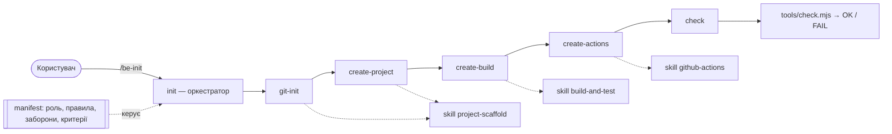

# Архітектура AI-агента build-engineer

## 1. Яку проблему вирішує агент

Навіть мінімальний кросплатформний проєкт потребує низки однакових кроків: каркас, `.gitignore`, складання,
тести, виконуваний файл, CI для трьох ОС. Агент `build-engineer` перетворює їх на повторюваний процес: кожна
операція — окрема команда з передумовами й перевірками, кожен клас задач — skill, а оркестратор `init` виконує
все по черзі й зупиняється на першій помилці. Запуск агента на гілці `develop` відтворює `feature/lab1-hello-ts`.

## 2. Skills

| Skill | Вхід | Результат | Перевірка |
|---|---|---|---|
| `project-scaffold` | `LANGUAGE`, `PROJECT_NAME` | `src/main.ts`, `src/greeting.ts`, розділ README, `.gitignore`, `.gitattributes` | `node src/main.ts` → `Hello, World!` |
| `build-and-test` | `PROJECT_NAME` | `package.json`, `tsconfig.json`, `vitest.config.ts`, `sea-config.json`, `src/math.ts`, `tests/basic.test.ts`, `scripts/build-sea.mjs`, `ci.sh`, `ci.bat` | `.\ci.bat` / `bash ci.sh` → `CI OK`, тест `BasicAddition` |
| `github-actions` | `ci.sh`, `ci.bat` | `.github/workflows/ci.yml` | `check --only workflow` → W1–W5 |

Skill містить точний вміст файлів, тому результат не залежить від моделі, а повторний запуск дає `UNCHANGED`.

## 3. Commands для користувача

| Команда | Виклик | Що робить |
|---|---|---|
| `git-init` | `/be-git-init` | перевіряє репозиторій, доповнює `.gitignore` і `.gitattributes`, показує стан Git |
| `create-project` | `/be-create-project` | skill `project-scaffold`: каркас застосунку |
| `create-build` | `/be-create-build` | skill `build-and-test`: складання, тест, `hello`, `ci.sh` / `ci.bat` |
| `create-actions` | `/be-create-actions` | skill `github-actions`: workflow CI |
| `check` | `/be-check` | перевіряє все (`tools/check.mjs`), нічого не змінюючи |
| `init` | `/be-init` | оркестратор: п'ять команд по черзі |

## 4. Дані між етапами

| Звідки → куди | Дані |
|---|---|
| користувач → `init` | `projectName` (за замовчуванням `hello-ts`) |
| `init` → `create-project`, `create-build` | `PROJECT_NAME`, `LANGUAGE=TypeScript` |
| кожен крок → підсумковий звіт | статуси файлів (`CREATED` / `UPDATED` / `UNCHANGED` / `CONFLICT`), коди виходу |
| `create-build` → `check`, CI | `build/hello.cjs`, `build/hello(.exe)`, `build/test-results/junit.xml` |
| `check` → користувач | таблиця `[ OK ]` / `[FAIL]` і код виходу |

## 5. Обробка помилок оркестратором

1. Перед стартом `init` перевіряє Git, Node.js ≥ 22.18, npm і робочий каталог.
2. Ненульовий код виходу чи `CONFLICT` зупиняє сценарій: наступні кроки не виконуються, агент виводить
   `init: FAILED на кроці N (<команда>) — <причина>. Дія: ...`.
3. Змінений вручну файл ніколи не перезаписується, тому повторний запуск безпечний.
4. Робота не вважається успішною без `check` з кодом 0. `check` ловить вимкнені тести (P3, B2), приховані
   помилки в `ci.sh` / `ci.bat` (P4) і `continue-on-error` чи зайві команди у workflow (W4).

## 6. Відповідність рекомендованій структурі

Структура збігається з рекомендованою в методичці (формат GitHub Copilot). Відмінності:

| Методичка | Тут | Чому |
|---|---|---|
| `CMakeLists.txt` | `package.json`, `tsconfig.json`, `sea-config.json`, `scripts/build-sea.mjs` | варіант 6: npm scripts; Node.js SEA дає виконуваний файл `hello` |
| GoogleTest / CTest | Vitest: `tests/basic.test.ts`, `vitest.config.ts` | варіант 6 |
| commands `init`, `check`, … | `name: be-init`, `be-check`, … | назву `/init` уже має вбудована команда |
| — | `tools/check.mjs` | детермінована перевірка для команди `check` |
| — | `ci.sh`, `ci.bat`, `.gitattributes` | скрипти CI; CRLF для `ci.bat` |
| — | `docs/ai-log.md` | журнал взаємодії з AI |
